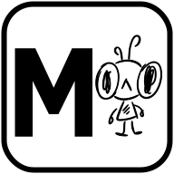
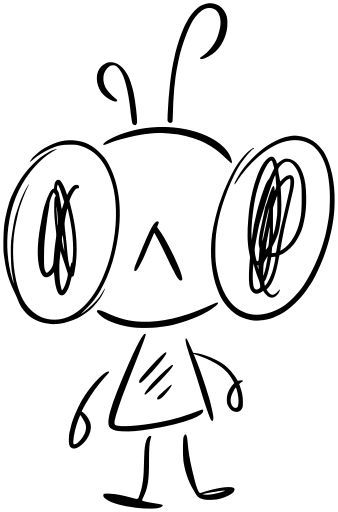

# Branding: m-agent und Scribbles

<p align="center">
  
  &nbsp;&nbsp;&nbsp;
  
</p>

## Name

- Produktname: **moritz-agent**, Kurzform **m-agent**.
- Der Assistent heißt **Anton** (männlich, Stimme Thorsten-Voice Hessisch); so stellt er sich am Telefon und in der Oberfläche vor
  (Begrüßung PHONE-21, ADR-026). Produkt- und Repo-Name bleiben moritz-agent / m-agent.

## Maskottchen: Scribbles

**Scribbles** ist das Maskottchen von LayerNX und ab sofort auch von moritz-agent – überall:

| Ort | Verwendung |
| --- | --- |
| Logo / Favicon / Icons | M + Scribbles (`m-agent-logo.svg`, `m-agent.ico`, `niko.ico`, `nikogreen.ico`) |
| WebUI | Login-Seite, Lade- und Wartezustände („Scribbles denkt nach …“), leere Listen, Fehler- und 404-Seiten, Über-Seite |
| Statusseite (Part 1) | Kopfzeile mit Logo; Scribbles bei „Alles läuft“ bzw. Störung |
| Doku / README / GitHub | Logo im README, Scribbles in Branding- und Hilfeseiten |
| Discord | Profilbild des Bots Anton (`discord-avatar.png`) |
| Android-App (später) | App-Icon = Logo, Splash-Screen = Scribbles |

Regeln:

1. **Monochrom.** Schwarz auf Weiß (`scribbles-black.*`) für helle Flächen, Weiß auf
   Transparent (`scribbles-white.*`, entspricht dem Original) für dunkle Flächen. Keine Farben,
   keine Verläufe.
2. **Nicht verzerren, nicht neu zeichnen.** Nur proportional skalieren. Neue Posen/Varianten
   kommen von Moritz als Zeichnung und werden wie das Original eingepflegt.
3. **SVG bevorzugen** (scharf in jeder Größe); PNG nur, wo SVG nicht geht.
4. Mindestgröße für Scribbles allein: 48 px Höhe. Darunter das Logo verwenden.
5. Assets **nie von Hand** bearbeiten, sondern `scripts/build_branding.py` ausführen.

## Dateien

| Datei | Inhalt |
| --- | --- |
| `scribbles/scribbles-original.png` | Original-Zeichnung von Moritz (weiße Linien, transparent) – Quelle für alles |
| `scribbles/scribbles-black.svg`, `-black-512.png` | Scribbles schwarz, vektorisiert |
| `scribbles/scribbles-white.svg`, `-white-512.png` | Scribbles weiß, vektorisiert |
| `m-agent-logo.svg`, `-512.png`, `-192.png`, `-64.png` | Logo: fettes M + Scribbles im abgerundeten Rahmen |
| `m-agent.ico` | Icon 16–256 px (identisch mit `niko.ico` / `nikogreen.ico` im Wurzelverzeichnis) |
| `discord-avatar.png` | Profilbild für den Discord-Bot Anton: weiße Scribbles auf Dunkel, 512 × 512 (`python -m moritz_agent.discord profile` lädt es hoch) |

## Neu erzeugen

```bash
pip install pillow numpy potracer cairosvg
python scripts/build_branding.py
```

## Rechte

Scribbles und das m-agent-Logo: **© LayerNX / Moritz Eckhard Nickel – alle Rechte vorbehalten.**
Sie fallen weder unter die MSOL 1.1 (eigener Code) noch unter die AGPL (KoboldCpp). Wer
moritz-agent abwandelt und weitergibt, ersetzt Logo und Maskottchen durch eigene
(siehe [`LICENSING.md`](../../LICENSING.md)).
